<div align="center">
  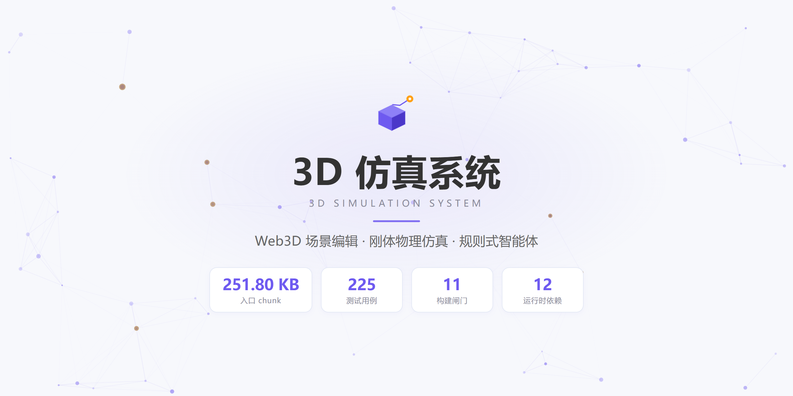
</div>

<h1 align="center">
  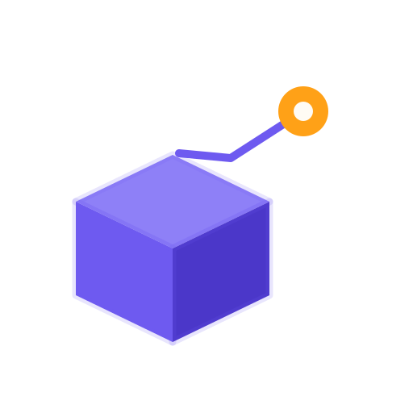
  3D 仿真系统
</h1>
<p align="center"><b>基于 Vue 3 + Three.js + Rapier3D 的 Web3D 场景编辑与物理仿真平台</b></p>

<p align="center">
  <a href="https://www.npmjs.com/package/vue"></a>
  <a href="https://threejs.org/"></a>
  <a href="https://rapier.rs/"></a>
  <a href="https://vite.dev/"></a>
  <a href="https://www.typescriptlang.org/"></a>
  
  
  <a href="LICENSE"></a>
</p>

<div align="center">
  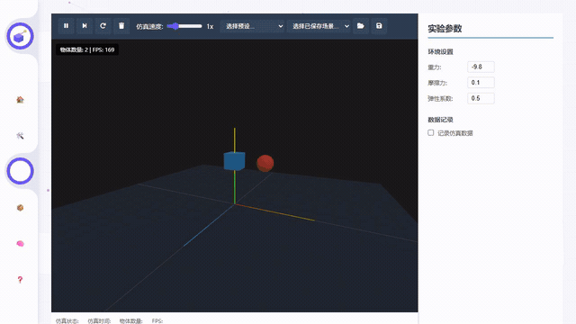
  <br>
  <sub>真实运行录屏（生产产物）· <a href="docs/assets/demo.mp4">下载 720p MP4</a></sub>
</div>

<table>
  <tr>
    <td align="center"><b>251.65 KB</b><br><sub>入口 chunk · 上限 1.5 MB</sub></td>
    <td align="center"><b>238</b><br><sub>测试用例 · 29 个文件</sub></td>
    <td align="center"><b>10</b><br><sub>构建闸门 · 全绿</sub></td>
    <td align="center"><b>11</b><br><sub>运行时依赖 · 审计前 34</sub></td>
    <td align="center"><b>239</b><br><sub>死类名 · 审计前 757</sub></td>
    <td align="center"><b>9</b><br><sub>模型 · 全部自制</sub></td>
  </tr>
</table>

<p align="center">
  <a href="#这是什么">这是什么</a> ·
  <a href="#核心能力">核心能力</a> ·
  <a href="#界面">界面</a> ·
  <a href="#模型与资产">模型与资产</a> ·
  <a href="#快速开始">快速开始</a> ·
  <a href="#架构">架构</a> ·
  <a href="#质量保障">质量保障</a> ·
  <a href="#许可证">许可证</a>
</p>

---

## 这是什么

一个**工程化**的 3D 场景编辑与仿真平台：左边编辑场景，右边跑物理，中间能放规则式智能体。

它不是一个「能跑就行」的 demo。这个仓库做过一次**完整的代码审计**——19 份实施计划、4 轮独立复核，审计报告与实施计划都在仓库外归档。审计前 `npm run build` 跑不过、物理循环启动就死、删个物体刚体还在场上碰撞、模型在生产环境 404、模型库展示的全是编出来的数字。现在这些全部修掉，并且用 **10 道构建闸门**守住不回退。

## 核心能力

<div align="center">
<table>
<tr>
<td width="33%" valign="top" align="center">
<b>🛠️ 场景编辑器</b><br><br>
<sub>拖拽式放置基本体与模型，属性面板实时改变换，改完立刻写回刚体与碰撞体</sub>
</td>
<td width="33%" valign="top" align="center">
<b>🔬 仿真实验室</b><br><br>
<sub>固定步长刚体物理，速度与帧率解耦，预设场景一键切换</sub>
</td>
<td width="33%" valign="top" align="center">
<b>🤖 AI 演武场</b><br><br>
<sub>Rapier 刚体物理 + 规则式智能体读真实感知自主移动</sub>
</td>
</tr>
<tr>
<td width="33%" valign="top" align="center">
<b>📦 模型资源库</b><br><br>
<sub>9 个内置条目<b>全部可加载</b>，且全部是本仓库自己生成的</sub>
</td>
<td width="33%" valign="top" align="center">
<b>📚 系统文档</b><br><br>
<sub>11 篇正文，API / 指南 / 示例三类，全部与源码逐词交叉核对</sub>
</td>
<td width="33%" valign="top" align="center">
<b>🎨 浅色科技网络</b><br><br>
<sub>Canvas 2D 自绘背景，零 Babylon 依赖，全站靛紫单主色</sub>
</td>
</tr>
</table>
</div>

**它真正做对的几件事：**

- **一个场景只有一套物理。** 手写积分器和 Rapier 并行驱动同一个物体的历史已经删干净，Rapier 是唯一权威。
- **AI 演武场跑的是真物理。** 智能体与障碍物都是 Rapier 刚体：转向用冲量实现，"撞上会被挡下并沿箱体滑开"是接触求解器的结果，不是代码里手写的滑动；感知（视野内障碍物数量、最近距离）来自引擎的形状查询，撞没撞上来自接触流形。此前这里是解析式包围盒判定，没有摩擦、弹性与质量。
- **仿真速度与显示刷新率解耦。** 60Hz / 30Hz / 15Hz 屏上都是 **60.3~60.6 步/秒**——此前同一场景在 30Hz 屏上只跑 44% 速度。
- **Vue 不再代理 three.js 对象。** `objects` 用 `shallowRef`、`threeObject` 打 `markRaw`，属性面板不再每帧遍历整棵场景图：每帧属性访问 **410.7 → 44.4（−89.2%）**，`ScriptDuration` **−92.4%**。
- **改变换真的改到物理上。** 属性面板改位置 / 旋转 / 缩放 → 走 `update-transform` 事件写回刚体与碰撞体，缩放会同步重建碰撞体形状。
- **界面不编数字。** 模型库的文件大小、面数、材质数、动画数取自 GLB 实测值；占位条目显示「—」；本次会话上传显示「待分析」。
- **外部资源零运行时依赖。** 不再从海外 CDN 拉字体与随机图，全部本地化，并落 CSP。

## 界面

<div align="center">
<table>
<tr>
<td width="33%" align="center">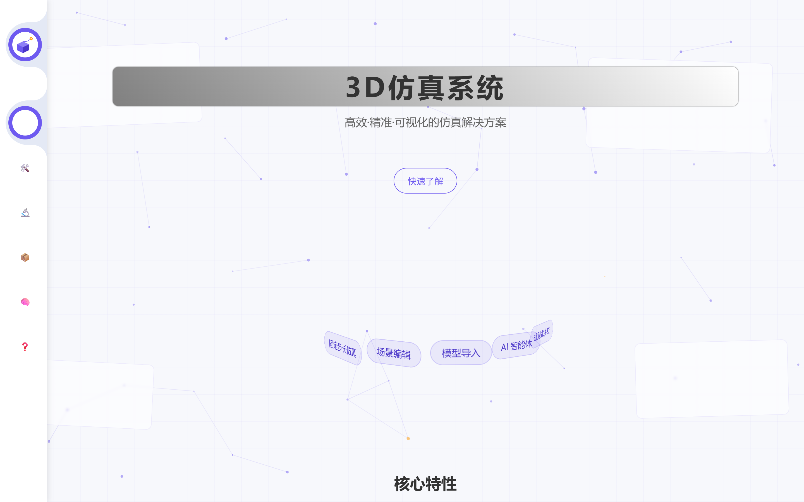<br><sub>总览页</sub></td>
<td width="33%" align="center">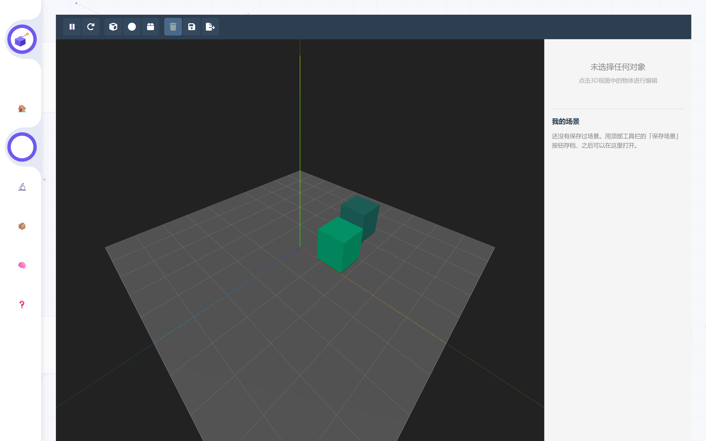<br><sub>场景编辑器</sub></td>
<td width="33%" align="center">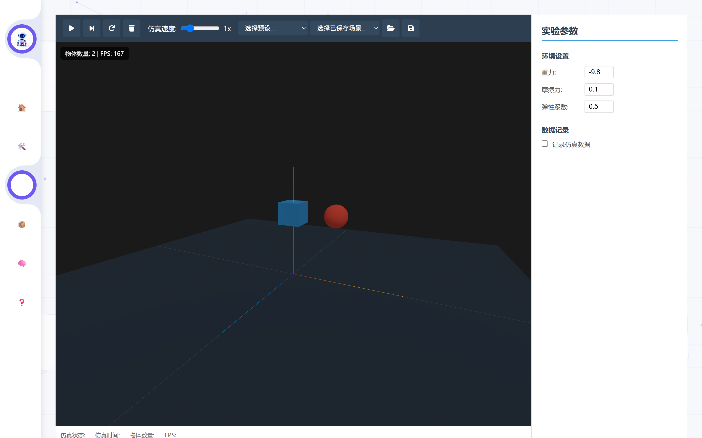<br><sub>仿真实验室</sub></td>
</tr>
<tr>
<td width="33%" align="center">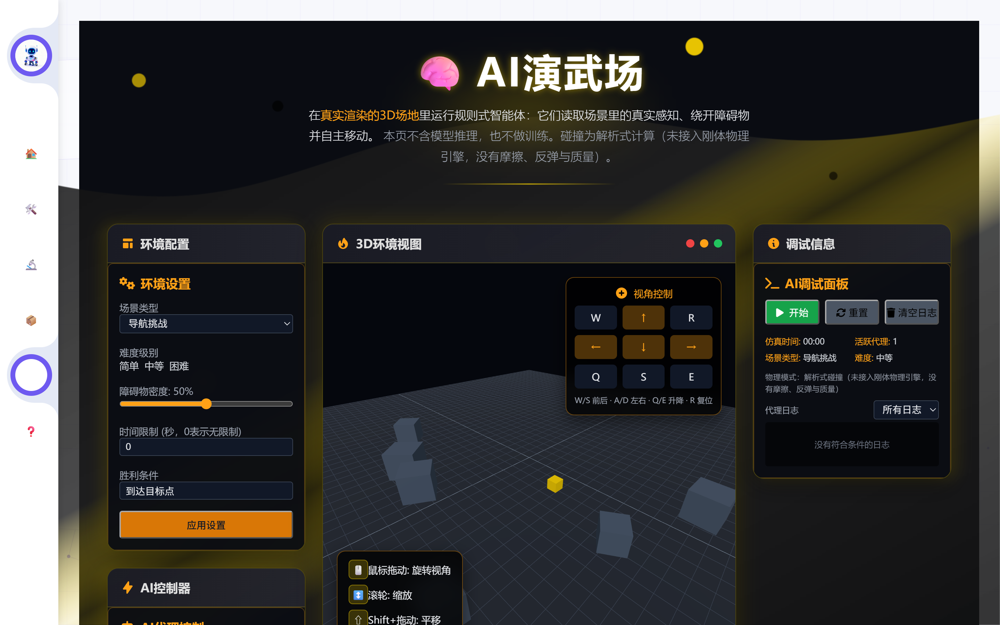<br><sub>AI 演武场</sub></td>
<td width="33%" align="center">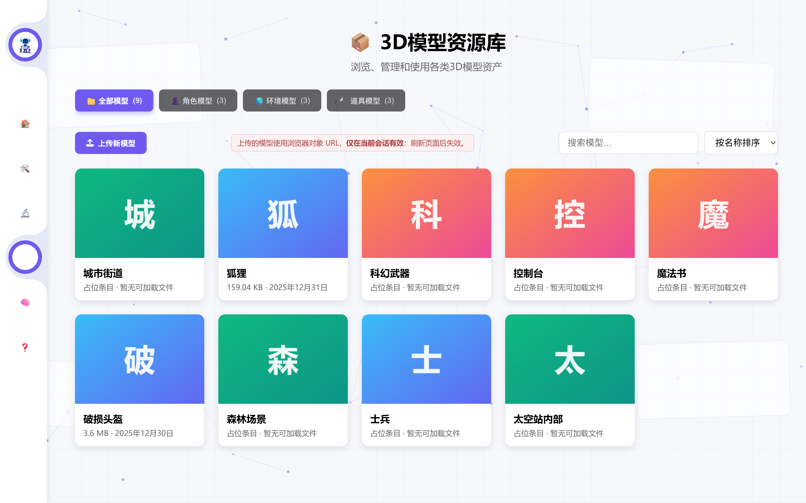<br><sub>模型资源库</sub></td>
<td width="33%" align="center">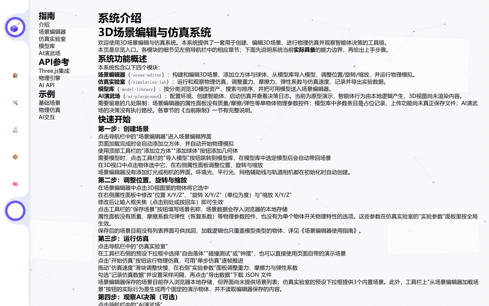<br><sub>系统文档</sub></td>
</tr>
</table>
</div>

## 模型与资产

这个仓库里的 3D 资产**全部是自己生成的**，没有一件是找来的素材。三条流水线都是声明式输入 + 确定性输出：

| 命令 | 做什么 | 输入 |
| --- | --- | --- |
| `npm run gen:models` | 用 three.js 基本体拼装模型、归一化尺寸、导出 GLB | `scripts/model-recipes.mjs` 的几何配方 |
| `npm run gen:thumbnails` | 从**导出的文件**渲染缩略图（透明背景） | `public/assets/models/**/*.glb` |
| `npm run gen:brand` | 从矢量母版栅格化出 logo 与 favicon | `src/assets/images/logo.svg` |

为什么自己造：**零许可风险**（随 Apache-2.0 发布，不像外部素材要逐个查协议、逐个署名）、**确定性**（同一份配方永远产出同样的文件，可以纳入闸门核对）、**体量与面数可控**。

模型库里的 9 个条目全部可加载，卡片上显示的**就是这些文件本身的渲染**：

<div align="center">
<table>
<tr>
<td width="16%" align="center">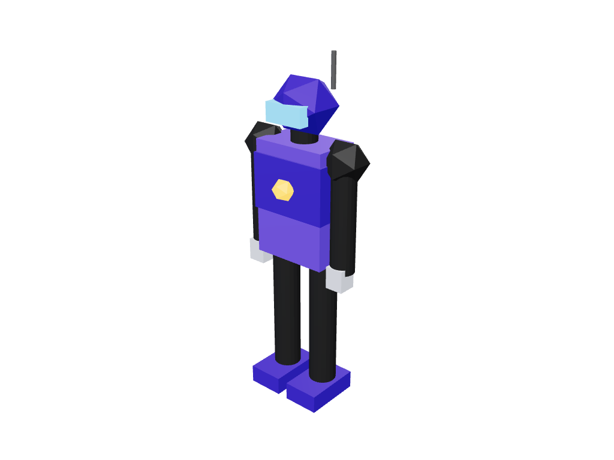<br><sub>机甲</sub></td>
<td width="16%" align="center">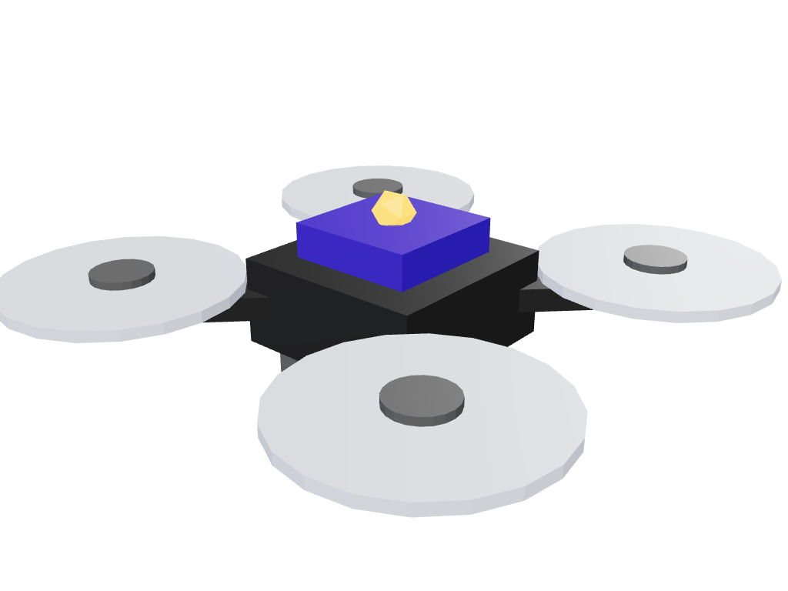<br><sub>无人机</sub></td>
<td width="16%" align="center">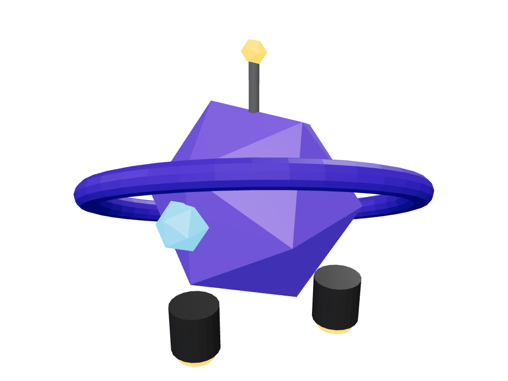<br><sub>悬浮守卫</sub></td>
<td width="16%" align="center">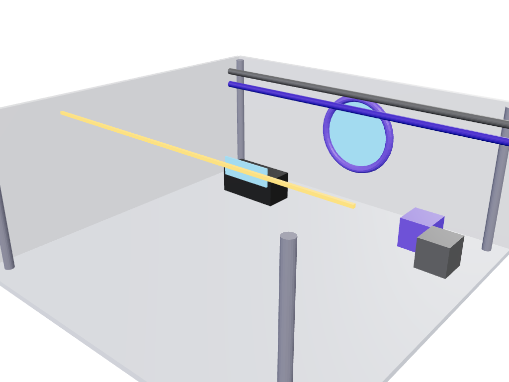<br><sub>太空站内部</sub></td>
<td width="16%" align="center">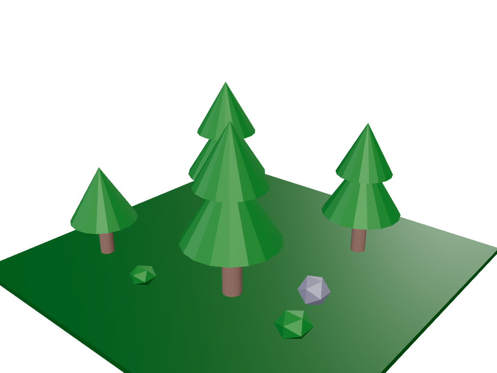<br><sub>森林场景</sub></td>
<td width="16%" align="center">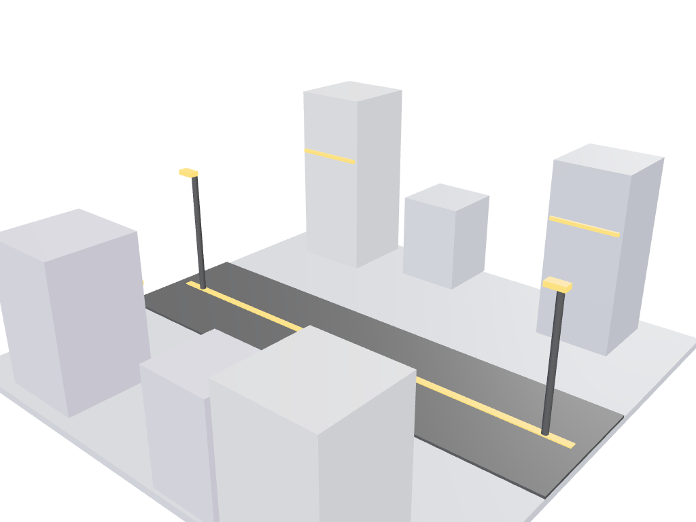<br><sub>城市街道</sub></td>
</tr>
<tr>
<td width="16%" align="center">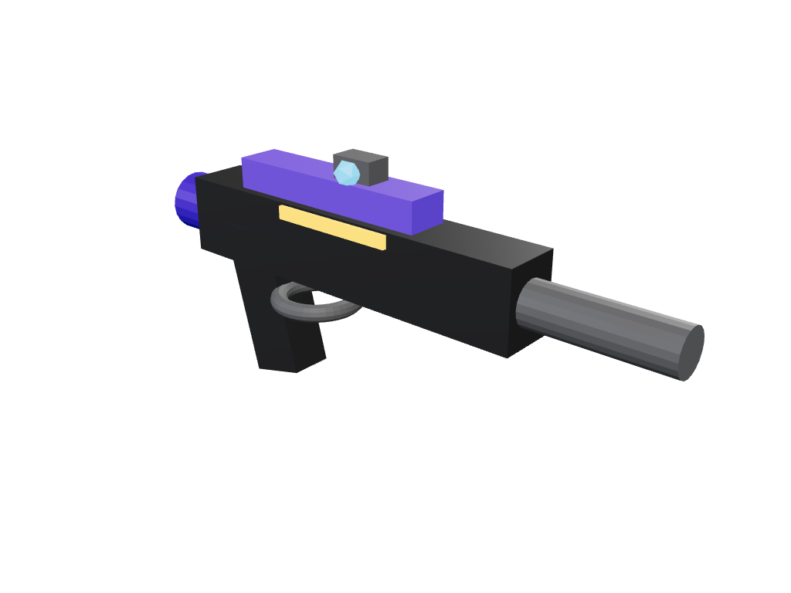<br><sub>科幻武器</sub></td>
<td width="16%" align="center"><br><sub>魔法书</sub></td>
<td width="16%" align="center">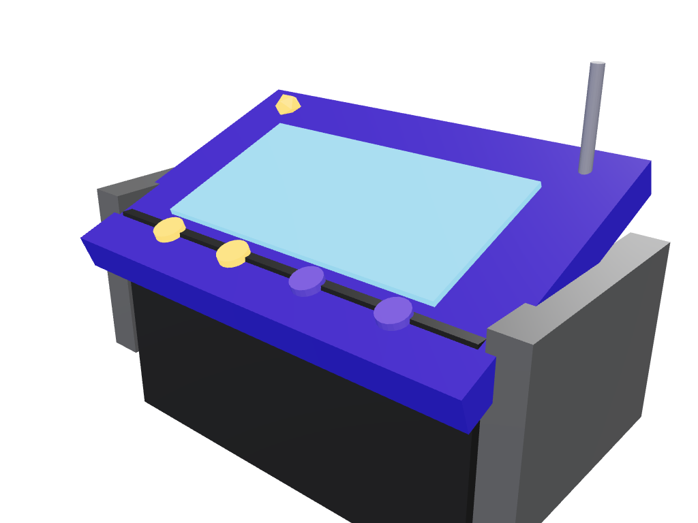<br><sub>控制台</sub></td>
<td colspan="3" align="center"><sub>—— 全部由本仓库的几何配方生成，无第三方素材</sub></td>
</tr>
</table>
</div>

> **改造型只需要改配方。** 加一个零件、改个颜色、重跑 `npm run gen:models && npm run gen:thumbnails` 就行。
> 几何配方长这样：
>
> ```js
> P(G.box(0.42, 0.62, 0.26), [0, 1.13, 0], '#6E5AF0'),            // 躯干
> P(G.icosa(0.06), [0, 1.22, 0.16], '#FFA117', { emissive: '#FFA117' }), // 胸口能源
> ```

## 快速开始

```bash
# Node 20+
git clone https://github.com/Echovagant/3D-Simulation-System.git
cd 3D-Simulation-System
npm install

npm run dev        # 开发服务器
npm run build      # 类型检查 + 构建 + 测试 + 10 道闸门
npm run preview    # 预览生产产物
```

浏览器打开 `http://localhost:5173`。左侧是导航，依次是：首页 / 总览 / 场景编辑器 / 仿真实验室 / 模型资源库 / AI 演武场 / 系统文档。

**常用命令**

| 命令 | 作用 |
| --- | --- |
| `npm run dev` | 开发服务器 |
| `npm run build` | `type-check` + `vite build` + `npm test` + 10 道闸门 |
| `npm test` | Vitest 全量用例（28 文件 / 225 例） |
| `npm run type-check` | `vue-tsc` 类型检查（零错误） |
| `npm run verify:all` | 单独跑全部校验闸门 |
| `npm run gen:models` | 重新生成程序化模型（几何配方在 `scripts/model-recipes.mjs`） |
| `npm run gen:thumbnails` | 从真实模型文件重新渲染缩略图 |
| `npm run gen:brand` | 从 SVG 母版重新生成 logo 与 favicon |
| `npm run gen:docs` | 重新生成 README 封面与页面截图 |
| `npm run record:demo` | 重新录制 README 顶部的演示视频 |
| `npm run format` | Prettier 格式化（只对 `src/` 下的非 `.vue` 文件安全） |

## 技术栈

| 领域 | 选型 | 版本 |
| --- | --- | --- |
| 框架 | Vue | 3.5.44 |
| 构建 | Vite + Vue Plugin | 6.4.4 / 6.0.1 |
| 语言 | TypeScript | 5.8.3 |
| 渲染 | Three.js | 0.180.0 |
| 物理 | Rapier3D（WASM） | 0.19.3 |
| 状态 | Pinia | 3.0.3 |
| 路由 | Vue Router | 4.5.1 |
| 文档渲染 | marked + DOMPurify | 16.3.0 / 3.4.17 |
| 测试 | Vitest + jsdom | 5.0.5 / 30.x |
| 图标 | Font Awesome Free | 6.7.2 |

> **本项目没有接 Tailwind。** 样式是手写 CSS + CSS 变量，令牌层见 [`DESIGN.md`](DESIGN.md)。
> 模板里若出现 `flex-1` / `lg:col-span-6` 这类工具类，它们**不生效**——
> 仓库有 `scripts/check-tailwind-classes.mjs` 闸门盯着死类名数量不增长。

## 架构

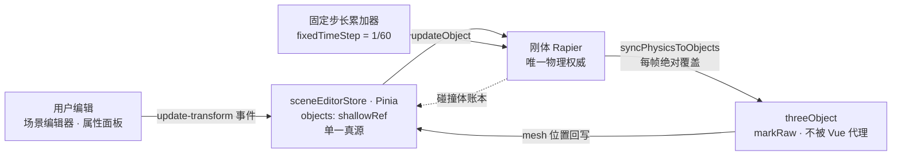

**三条硬规则**

1. **Rapier 是唯一权威。** 物体的变换只有一条通路：`用户编辑 → update-transform 事件 → 刚体 → syncPhysicsToObjects → mesh`。没有第二条写入路径。
2. **three.js 对象不进 Vue 响应式。** `objects` 用 `shallowRef` + 整体替换数组；`threeObject` 打 `markRaw`。
3. **仿真按固定步长推进。** 真实时间累加到累加器，按 `fixedTimeStep = 1/60` 切成整步，步数与显示帧率无关。

## 质量保障

`npm run build` 会在构建链上依次跑完这些闸门，**任何一道不过，构建就失败**：

| 闸门 | 守什么 |
| --- | --- |
| `verify:clean` | `src/` 下不能有编译产物泄漏 |
| `verify:no-babylon` | Babylon 残留（背景已换成 Canvas 2D） |
| `verify:overview-contrast` | 总览页 13 个前景的 WCAG AA + 禁用色 |
| `verify:docs` | 文档不能是 0 字节 |
| `verify:bundle-size` | 入口 chunk ≤ 1.5 MB |
| `verify:deps` | 20 个零引用依赖不得复活 |
| `verify:tailwind` | 死 Tailwind 类名不得超过 239 处 |
| `verify:model-metadata` | 模型库的文件属性与缩略图必须与磁盘上的 GLB 一致 |
| `verify:readme` | README 里的数字、图片、锚点必须与真实产物一致 |
| `verify:asset-licenses` | 每个资产的来源与协议都要清楚，不得有带限制的协议 |
| `npm test` | 29 个测试文件 / 238 个用例 |

**当前实测**

| 指标 | 数值 |
| --- | --- |
| 入口 chunk | **251.65 KB**（上限 1536 KB） |
| 产物体积 | 5.45 MB |
| 运行时依赖 | 11 个（审计前 34 个） |
| 测试 | 29 文件 / 238 例全绿 |
| 类型检查 | 0 错误 |
| 7 个页面 | 0 console error / 0 console warning / 0 未捕获异常 / 0 网络失败 |
| 死 Tailwind 类名 | 757 → **239** |
| 可加载模型 | 9 个（**全部程序化生成**） |

> 早先唯一的 console 输出是 **Rapier compat 包内部**的弃用警告
> （`using deprecated parameters for the initialization function`）——
> 那个包把 1.5MB 的 WASM 以 base64 内联进 JS，产物里因此多出一个 2.2MB 的 chunk。
> 现在物理引擎统一走官方包（`@dimforge/rapier3d`，WASM 拆成独立资源、多页共享），
> 警告没了，产物也瘦了 **2.16 MB**。

**这仓库刚做完一次全面审计**——19 份实施计划、4 轮独立复核，发现的问题全部落地并用闸门守住。审计报告与实施计划归档在仓库外（含逐条处置记录与被驳回的误判）。

<details>
<summary><b>项目结构</b></summary>

```
src/
├── components/
│   ├── three/            # 3D 场景：core / panels / ai
│   ├── common/Background # Canvas 2D 科技网络背景
│   └── docs/             # 文档渲染
├── composables/          # useSceneEditor（刚体权威）/ usePhysics / useThree / useAI
├── stores/               # Pinia：场景编辑器 / 仿真 / 模型 / AI
├── views/                # 7 个页面
├── docs/                 # 11 篇文档正文（会被渲染进系统文档页）
├── utils/                # 固定步长累加器 / markdown 渲染 / 缩略图 …
└── assets/
    ├── images/logo.svg   # 品牌标识母版（矢量）
    └── styles/           # 主题令牌 + AI 面板工具层
scripts/
├── model-recipes.mjs     # 9 个模型的几何配方（声明式）
├── generate-model-assets.mjs    # 配方 -> GLB
├── render-model-thumbnails.mjs  # GLB -> 缩略图
├── generate-brand-assets.mjs     # SVG 母版 -> logo / favicon
├── generate-docs-assets.mjs      # 封面 + 页面截图
├── record-demo.mjs                # 录制 README 顶部的演示视频
├── check-model-metadata.mjs      # 模型属性与 GLB 实测对账
├── check-asset-licenses.mjs      # 资产来源与协议核对
└── ...                          # 其余 9 道闸门
public/assets/models/     # 9 个模型 + 9 张渲染缩略图（全部自制）
docs/assets/              # 封面 + 演示视频（GIF / MP4）
docs/screenshots/         # 7 张页面截图
```

</details>

## 文档

系统内置 11 篇文档（`/docs`），也以 Markdown 形式放在 [`src/docs/`](src/docs)：

- **使用指南** — 场景编辑器 / 仿真实验室 / AI 演武场 / 模型资源库 的上手
- **API 参考** — Three.js 集成 / 物理引擎 / AI 接口
- **示例教程** — 基础场景 / 物理仿真 / AI 交互

## 贡献

欢迎提 Issue 与 PR。动手前请先读 [`DESIGN.md`](DESIGN.md)（设计令牌唯一真源）与本 README 的「质量保障」——**改完必须跑 `npm run build`**，10 道闸门全绿才算完成。

## 许可证

本项目采用 **Apache License 2.0**，完整文本见 [`LICENSE`](LICENSE)。

仓库里的**每一份非源码资产都是本项目自己生成的**——9 个 3D 模型、9 张模型缩略图、站点 logo、favicon、README 封面与页面截图，全部由 `npm run gen:models` / `gen:thumbnails` / `gen:brand` / `gen:docs` 生成，随 Apache-2.0 发布，**不含任何第三方模型、贴图或字体素材**。

`verify:asset-licenses` 闸门会持续核对这件事：每个资产的来源都要有交代，不得出现带限制或传染性的协议，依赖里也不允许混进 GPL / AGPL / CC-BY-NC。

## 致谢

- [Three.js](https://threejs.org/) — 渲染
- [Rapier](https://rapier.rs/) — 刚体物理
- [Vue](https://vuejs.org/) / [Vite](https://vite.dev/) / [Pinia](https://pinia.vuejs.org/) — 框架层
- [Font Awesome Free](https://fontawesome.com/) — 图标
