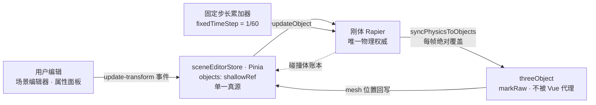

<h1 align="center">
  
  3D 仿真系统
</h1>
<p align="center"><b>基于 Vue 3 + Three.js + Rapier3D 的 Web3D 场景编辑与物理仿真平台</b></p>

<p align="center">
  <a href="https://www.npmjs.com/package/vue"></a>
  <a href="https://threejs.org/"></a>
  <a href="https://rapier.rs/"></a>
  <a href="https://vite.dev/"></a>
  <a href="https://www.typescriptlang.org/"></a>
  
  
  <a href="LICENSE"></a>
</p>

<div align="center">
  
  <br>
  <sub>真实运行录屏（生产产物）· <a href="docs/assets/demo.mp4">下载 720p MP4</a></sub>
</div>

<table>
  <tr>
    <td align="center"><b>256.35 KB</b><br><sub>入口 chunk · 上限 1.5 MB</sub></td>
    <td align="center"><b>366</b><br><sub>测试用例 · 40 个文件</sub></td>
    <td align="center"><b>11</b><br><sub>构建闸门 · 全绿</sub></td>
    <td align="center"><b>4</b><br><sub>后端闸门 · ruff/mypy/pytest</sub></td>
  </tr>
</table>

<p align="center">
  <a href="#这是什么">这是什么</a> ·
  <a href="#功能">功能</a> ·
  <a href="#界面">界面</a> ·
  <a href="#模型">模型</a> ·
  <a href="#快速开始">快速开始</a> ·
  <a href="#技术栈">技术栈</a> ·
  <a href="#架构">架构</a> ·
  <a href="#质量保障">质量保障</a> ·
  <a href="#文档">文档</a> ·
  <a href="#许可证">许可证</a>
</p>

---

## 这是什么

一个 Web3D 场景编辑与物理仿真平台：**左边编辑场景，右边跑物理，中间放智能体**。

7 个页面：首页 / 总览 / 场景编辑器 / 仿真实验室 / 模型资源库 / AI 演武场 / 系统文档。
物理由 **Rapier** 承担，它是场景与智能体行为的唯一权威。

## 功能

<div align="center">
<table>
<tr>
<td width="33%" valign="top" align="center">
<b>🛠️ 场景编辑器</b><br><br>
<sub>拖拽放置基本体与模型，属性面板改完立刻写回刚体与碰撞体</sub>
</td>
<td width="33%" valign="top" align="center">
<b>🔬 仿真实验室</b><br><br>
<sub>固定步长刚体物理，仿真速度与帧率解耦，预设场景一键切换</sub>
</td>
<td width="33%" valign="top" align="center">
<b>🤖 AI 演武场</b><br><br>
<sub>智能体读真实感知自主移动；可选接入 11 家 LLM 服务商做决策与解释</sub>
</td>
</tr>
<tr>
<td width="33%" valign="top" align="center">
<b>📦 模型资源库</b><br><br>
<sub>9 个内置模型全部可加载，且全部由本仓库生成</sub>
</td>
<td width="33%" valign="top" align="center">
<b>📚 系统文档</b><br><br>
<sub>11 篇正文，API / 指南 / 示例三类，与源码逐词核对</sub>
</td>
<td width="33%" valign="top" align="center">
<b>🎨 浅色科技网络</b><br><br>
<sub>Canvas 2D 自绘背景，零 Babylon 依赖</sub>
</td>
</tr>
</table>
</div>

## 界面

<div align="center">
<table>
<tr>
<td width="33%" align="center"><br><sub>总览页</sub></td>
<td width="33%" align="center"><br><sub>场景编辑器</sub></td>
<td width="33%" align="center"><br><sub>仿真实验室</sub></td>
</tr>
<tr>
<td width="33%" align="center"><br><sub>AI 演武场</sub></td>
<td width="33%" align="center"><br><sub>模型资源库</sub></td>
<td width="33%" align="center"><br><sub>系统文档</sub></td>
</tr>
</table>
</div>

## 模型

模型库里的 9 个条目全部可加载，卡片上显示的就是这些文件本身的渲染。
**它们全部由本仓库的几何配方生成**（`npm run gen:models`），没有任何第三方素材。

<details>
<summary><b>展开 9 个模型</b></summary>

<div align="center">
<table>
<tr>
<td width="16%" align="center"><br><sub>机甲</sub></td>
<td width="16%" align="center"><br><sub>无人机</sub></td>
<td width="16%" align="center"><br><sub>悬浮守卫</sub></td>
<td width="16%" align="center"><br><sub>太空站内部</sub></td>
<td width="16%" align="center"><br><sub>森林场景</sub></td>
<td width="16%" align="center"><br><sub>城市街道</sub></td>
</tr>
<tr>
<td width="16%" align="center"><br><sub>科幻武器</sub></td>
<td width="16%" align="center"><br><sub>魔法书</sub></td>
<td width="16%" align="center"><br><sub>控制台</sub></td>
<td colspan="3" align="center"><sub>—— 全部程序化生成，随 Apache-2.0 发布</sub></td>
</tr>
</table>
</div>

</details>

## 快速开始

```bash
# Node 20+
git clone https://github.com/Echovagant/3D-Simulation-System.git
cd 3D-Simulation-System
npm install

npm run dev        # 开发服务器
npm run build      # 类型检查 + 构建 + 测试 + 11 道闸门
npm run preview    # 预览生产产物
```

浏览器打开 `http://localhost:5173`。

| 命令 | 作用 |
| --- | --- |
| `npm run dev` | 开发服务器 |
| `npm run build` | 类型检查 + 构建 + 测试 + 11 道闸门 |
| `npm test` | Vitest 全量用例（40 个测试文件 / 366 个用例） |
| `npm run verify:all` | 单独跑全部闸门 |
| `npm run verify:backend` | 后端闸门：ruff + 格式 + mypy + pytest |
| `npm run verify:api-contract` | 校验 API 契约文档与后端代码一致 |
| `npm run gen:api-contract` | 从后端代码重新生成 API 契约文档 |
| `npm run build:all` | 前后端一起跑（前端构建 + 后端闸门） |
| `npm run gen:models` | 用几何配方重新生成 9 个模型与缩略图 |
| `npm run gen:docs` | 重新生成封面与页面截图 |

## 后端（可选）

本项目默认是**纯前端**应用：`npm run build` 出来的产物可以直接扔到任何静态托管上。

仓库里另带一个 Python 后端（`backend/`），用来做浏览器天生做不到的事：

- **跨设备场景库**——在 A 设备保存的场景，B 设备打开就能看到；
- **LLM 托管**——不想自己填 Key 的人，把 Key 交给服务端加密保管，
  请求走后端，由后端做**配额、调用审计与故障转移**（一家厂商不通会自动换下一家）；
- **错误上报**——前端的错误现场收进后端，不只是控制台里滚过去就没了。

**后端缺席时前端功能完全不受影响**：场景仍然存在浏览器本地，
Key 仍然只留在本页内存里，错误仍然能在控制台看到，界面不会多出任何提示以外的打扰。

```bash
cd backend
uv sync
uv run uvicorn app.main:app --port 8000
```

前端要连后端时，开发服务器会把 `/api` 代理过去（用 `VITE_API_PROXY_TARGET` 指定后端地址）：

```bash
VITE_API_PROXY_TARGET=http://127.0.0.1:8000 npm run dev
```

后端自己的测试与质量检查：

```bash
cd backend
uv run pytest        # 63 个用例
npm run verify:backend   # ruff + 格式 + mypy + pytest
```

后端接口的契约文档 [`docs/api-contract.md`](docs/api-contract.md) 是**生成物**：
它由后端代码生成，改了接口却没重新生成，CI 会直接红。

## 技术栈

| 领域 | 选型 | 版本 |
| --- | --- | --- |
| 框架 | Vue | 3.5.44 |
| 构建 / 语言 | Vite · TypeScript | 6.4.4 · 5.8.3 |
| 渲染 | Three.js | 0.180.0 |
| 物理 | Rapier3D（WASM） | 0.19.3 |
| 状态 / 路由 | Pinia · Vue Router | 3.0.3 · 4.5.1 |
| 测试 | Vitest + jsdom | 5.0.5 / 30.x |
| 文档 / 图标 | marked · DOMPurify · Font Awesome Free | 16.3.0 / 6.7.2 |

> 样式是手写 CSS + CSS 变量，令牌层见 [`DESIGN.md`](DESIGN.md)。**本项目没有接 Tailwind**——
> 模板里的工具类不生效，仓库有闸门盯着死类名数量不增长。

## 架构



1. **Rapier 是唯一权威**——物体的变换只有一条通路：用户编辑 → 事件 → 刚体 → 同步 → mesh。
2. **three.js 对象不进 Vue 响应式**——`shallowRef` + `markRaw`，避免每帧遍历整棵场景图。
3. **仿真按固定步长推进**——真实时间按 1/60 秒切成整步，步数与显示帧率无关。

## 质量保障

`npm run build` 会依次跑完类型检查、构建、全部测试，并用 **11 道构建闸门**守住不回退：
入口体积、README 数字与产物对账、资产来源与协议、仓库里不许有疑似密钥、零引用依赖、
**死 Tailwind 类名不得超过 239 处** 等。任何一道不过，构建就失败。

| 指标 | 数值 |
| --- | --- |
| 产物体积 | 5.55 MB |
| 运行时依赖 | 11 个 |
| 可加载模型 | 9 个（全部程序化生成） |
| 类型检查 | 0 错误 |
| 页面体检 | 7 个页面 0 console error / 0 未捕获异常 / 0 网络失败 |

后端另有一道独立的 Python 闸门：**ruff 静态检查 + 格式检查 + mypy 类型检查 + pytest**。
CI 在 Python 3.12 / 3.13 / 3.14 三个版本上各跑一遍——
`requires-python` 声明的下限是真的被验证过的，不是写在纸上的。

## 文档

系统内置 11 篇文档（`/docs`），也以 Markdown 形式放在 [`src/docs/`](src/docs)：
使用指南、API 参考、示例教程。

## 贡献

欢迎提 Issue 与 PR。动手前先读 [`DESIGN.md`](DESIGN.md)，
**改完必须跑 `npm run build`**，11 道闸门全绿才算完成。

## 许可证

**Apache License 2.0**，完整文本见 [`LICENSE`](LICENSE)。

仓库里的每一份非源码资产（9 个模型、9 张缩略图、logo、favicon、封面、页面截图）
都由本仓库的脚本生成，随 Apache-2.0 发布，**不含任何第三方模型、贴图或字体素材**。

## 致谢

- [Three.js](https://threejs.org/) — 渲染
- [Rapier](https://rapier.rs/) — 刚体物理
- [Vue](https://vuejs.org/) / [Vite](https://vite.dev/) / [Pinia](https://pinia.vuejs.org/) — 框架层
- [Font Awesome Free](https://fontawesome.com/) — 图标
